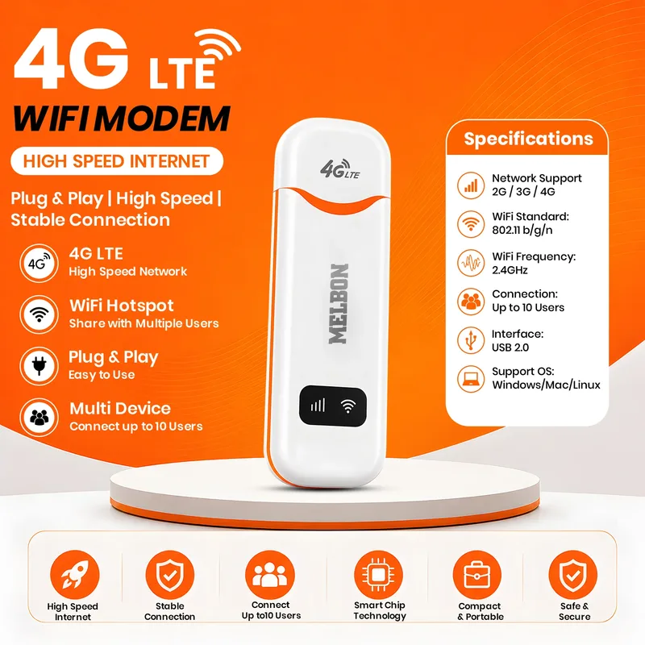
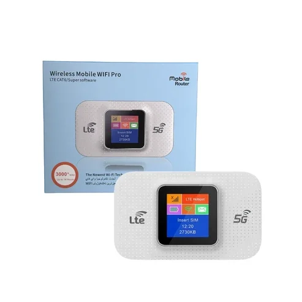

# KStick Router

Router firmware add-on for cheap Qualcomm **MSM8916 4G LTE dongles and pocket routers** running
[OpenStick](https://github.com/OpenStick/OpenStick) Debian. It turns the device into a small, manageable router:

- **Web UI** (HTTPS): status dashboards, LTE, Wi-Fi/LAN, DHCP, DNS, firewall, VPN, SMS, system. Two looks:
  **Classic** and a **Windows-XP-style desktop**.
- **Uplinks with failover:** LTE, a USB host PC, a joined Wi-Fi network (client mode), or a phone over Bluetooth tethering.
- **Safety nets:** risky changes are undone unless confirmed, a thermal guard, a hardware watchdog, battery protection.
- **SMS:** SMS and USSD in the UI, an SQLite SMS log, remote control by SMS, forwarding to WhatsApp, a webhook, Telegram
  or ntfy, and an optional public **SMS gateway API**.
- **Remote access:** Cloudflare Mesh (Cloudflare One client) and Cloudflare Tunnel, both optional.
- **Data usage:** per-day accounting with daily/monthly caps, schedules, per-device internet times, OS update blocking.
- **MF800 status screen:** dashboards on the 1.44" LCD of the MF800 pocket router.

The backend is Go (standard library only, plus `rsc.io/qr`). The front ends are plain JavaScript with no build step
and no dependencies.

## Supported hardware

| | KStick USB dongle | MF800 pocket router |
|---|---|---|
| Photo |  |  |
| Sold as | "4G LTE WiFi Modem" USB stick (2.4 GHz b/g/n hotspot, USB 2.0) | "Wireless Mobile WIFI Pro" (LTE Cat 6, 3000 mAh, colour screen; the "5G" label is marketing, it is 4G only) |
| Board | HMUF02 / UZ801 v3 (`yiming,uz801-v3`) | MF800 (`msm8916-fy-mf800-fixed.dtb`) |
| SoC / RAM | MSM8916, 4× Cortex-A53, ~317 MiB usable | same |
| Power | USB | battery + USB |
| Screen | LEDs only | GC9107 128×128 LCD (`deploy/mf800-lcd/`) |

Other MSM8916 boards supported by OpenStick should work; the hardware-specific parts (screen, battery) switch themselves
on only where the hardware exists. Neither board above has a GPS antenna: the modem reports GPS support, but sees no
satellites, so there is no GPS feature.

## Install

Requirements on the PC: Go (1.24+), `ssh`/`scp`, and optionally Node.js (syntax check of the XP UI).
Flash the device with OpenStick Debian first, and connect it by USB.

```sh
./kstick.sh install                 # default host user@192.168.68.1 (OpenStick's USB address)
./kstick.sh -H user@host install --wifi-ssid MyNet --wifi-pass 'secret' --apn internet
```

`kstick.sh` builds everything, copies a bundle to the device and runs `kstick-setup` there (also installed as
`/usr/local/sbin/kstick-setup`). Host: `-H user@host`, `$KSTICK_HOST` or the default. Extra ssh options:
`KSTICK_SSH_OPTS="-i key"`.

`install` sets up:
- your SSH key (asks for the device password once), packages (with temporary swap), the router programs and services;
- zram swap, a CPU clock cap, sysctl, a driver blacklist, a slim dpkg/journal;
- a Wi-Fi regulatory database the kernel accepts (`deploy/regdb/`, from the next boot);
- NetworkManager profiles `hotspot` (new devices get `KStick-XXXX` and a random password, printed at the end) and `lte`.

It is safe to re-run: existing settings and profiles are kept. SSH becomes key-only only if a key was installed.

| Option | |
|---|---|
| `--wifi-ssid`, `--wifi-pass`, `--apn` | hotspot and LTE settings |
| `--cpu-max-mhz N` | CPU cap (default 400; `0` = uncapped) |
| `--with-whatsapp` | the WhatsApp forward module (needs a WAWAT server) |
| `--with-warp [--warp-token FILE]` | Cloudflare One client for Cloudflare Mesh |
| `--cloudflared-token FILE` | Cloudflare Tunnel (for the public SMS gateway) |
| `--no-ssh-hardening`, `--no-slim`, `--no-blackbox` | skip those parts |

Then open `https://192.168.68.1` (USB) or `https://192.168.4.1` (Wi-Fi) and sign in with the device's system account
(`user` by default). The certificate is self-signed.

### Backup, restore, reset

- `./kstick.sh backup [file]`: a full backup to the PC (tar.gz, mode 600). It has the router settings, modules, forwarding
  configs, TLS certificate, SMS gateway config and API keys, all NetworkManager profiles (including WireGuard keys), the SMS
  log, Cloudflare tokens and registration, and the admin SSH keys. Skip parts with `--no-sms-log` and `--no-cloudflare`.
  A copy stays in `/var/backups/kstick/` on the device. (The web UI's System page backup covers only the router
  settings, Wi-Fi and LTE.)
- `./kstick.sh restore <file>`: restores only the paths above, after saving the current settings (`pre-restore-*`).
- `./kstick.sh reset [--all] [-y]`: clears the router settings, WireGuard tunnels, SMS gateway config and forwarding
  configs, after saving a backup (`pre-reset-*`). Wi-Fi, APN, USB link, SSH keys, password, SMS log and Cloudflare are
  kept unless `--all`.
- Run restore and reset over USB or Wi-Fi, not over Cloudflare Mesh: they restart the Mesh client.

### Updates (`deploy.sh`)

```sh
HOST=myrouter ./deploy.sh        # ssh host alias of the device
```

`deploy.sh` runs `go vet` and the tests, cross-compiles for arm64, builds the XP UI and installs what changed. It is
built to be light on an LTE link, because uploads heat the modem and cost data:
- The device keeps a mirror of the deployed files in `/var/lib/kstick-deploy` (no secrets). Only files whose SHA-256
  differs are sent, as one compressed stream (`xz -6` if available, else `gzip -9`). The 12 MB binary goes over as
  about 4 MB.
- The UI files are served from disk, so a UI-only change is a ~25 KB upload and needs no restart.
- Services restart only when their own files changed. With nothing changed, nothing is sent.
- Prefer deploying over USB, or when the device is cool.

## Web UI

Two front ends use the same API and settings:
- **Classic** (`web/`): a sidebar with one page at a time. This is the default.
- **Windows XP style** (`web-xp/`, built from `xp/src`): a desktop where every page opens as its own window, with a
  Start menu, a taskbar, a tray and balloon notifications. See `xp/README.md`.

To pick one:
- **For every browser:** System → Web interface (or `PUT /api/ui {"style":"xp"}`). It takes effect on the next page load.
- **For one browser:** open `https://<router>/?ui=classic` or `/?ui=xp` (a cookie; `/?ui=default` removes it). This is
  also the way back if one style ever breaks. The XP Control Panel has **Switch to Classic View**.

A style whose files are missing is never served; the device falls back to Classic.

The server sets a strict Content Security Policy (no inline scripts or styles, no frames) and answers only clients on
local networks (LAN, USB link, loopback) and Cloudflare Mesh addresses, behind the firewall.

## Features

### Operating modes (Network → Operating mode)

- **Router** (default): the Wi-Fi is a hotspot LAN with DHCP and DNS (dnsmasq), NAT, and LTE/USB uplinks.
- **Wi-Fi client:** the Wi-Fi joins an existing network (profile `wifi-client`) as the main uplink, with LTE as the
  backup. There is no hotspot, DHCP, DNS server, NAT or LAN.
  - Turned off when switching: LAN IPv6, VPN routing for the LAN, Mesh access to the LAN, the Wi-Fi off schedule.
  - Hidden: Clients & DHCP, Wi-Fi & LAN, DNS, Firewall and VPN (their write APIs answer 409).
  - Still working: SMS and USSD, the LTE pages, dashboards, Cloudflare Mesh, forwarding, schedules, system pages.
  - Firewall: only ICMP and the DHCP client in, plus the USB link, Mesh management and (optionally) SSH and the web UI from
    the joined network. Nothing is forwarded.

Switching must be confirmed within 3 minutes, or the previous mode comes back. Into client mode, dnsmasq stops before the
device joins the network; back in router mode, dnsmasq starts only after the hotspot is up. An existing profile for the
same network is adopted, so a working connection isn't interrupted.

**Recovery from a shell:** `sudo router-webui -set-mode router` (or `client`) switches at once, without the confirm step.

### Undo risky changes (confirm or revert)

Firewall, LAN (address/DHCP), VPN routing, IPv6, band lock and mode changes, and blocking a client, are applied at once
but undone after 90 s unless confirmed in the bar at the top of the UI (System → Undo risky changes; 0 turns it off).
A LAN address change gets at least 180 s: reconnect at the new address, sign in and confirm there. More risky changes
while one is pending join it. The pending change is saved to disk, so if the web UI restarts or the device reboots
before it is confirmed (for example, power-cycled after a lockout), it is reverted at start.

### Uplinks and failover

`wan-failover` checks the uplinks in order (default `wwan0 usb0`, plus `bnep0` for Bluetooth; `wlan0 wwan0 usb0` in
client mode) and moves the default route to the first healthy one. To keep the LTE radio idle, it doesn't ping a
healthy LTE link that shows two-way traffic, and probes an idle one only every `IDLE_PROBE` seconds (default 120). The
modem driver keeps no byte counters for `wwan0`, so LTE bytes are counted by the nft counters `lte_rx`/`lte_tx`.

**Backup internet through a phone (Bluetooth page):** a paired phone with Bluetooth tethering becomes the last uplink.
It is connected only when no other uplink has been healthy for 45 s, and disconnected once another one has been healthy
for 3 minutes. Phone data is not counted by the data usage meter.

### Data usage and caps (Status → Data usage)

Everything that crosses the LTE radio is totalled per day (the router's own traffic too, as the operator counts it) and
kept for 100 days in `/var/lib/router/datausage.json`.
- **Caps:** daily and/or monthly (MB), the month starting on a chosen day, a warning at a share of the cap. Warnings go
  to the log and, if SMS remote control notifications are on, by SMS.
- **At the cap:** only warn, slow LAN clients down (default 256 kbit/s each way), or cut them off from LTE. The router
  itself, Mesh, the web UI and SMS control keep working.

### Schedules (Network → Schedules)

- **LTE off** or **Wi-Fi off** in a daily window (they may not overlap).
- **Reboot** daily or weekly at a set time.
- **Device internet times:** `MAC days HH:MM-HH:MM name` per line; inside the window the device has no internet but
  keeps Wi-Fi and the LAN.

### Signal & bands (Network → Signal & bands)

While the page is open the modem measures every 2 s instead of 10 s: large RSRP / SINR / RSRQ readouts with a 3-minute
trail, for finding the best spot. **Band lock** limits the modem to the ticked LTE bands (confirm-or-revert, re-applied
if the modem forgets it).

**Cell tower card:** the serving cell (eNodeB and sector, band, PCI, neighbour cells), the distance to the tower from the
LTE timing advance (roughly ±80 m), and the tower's position from a cell database. The lookup sends the serving cell's
IDs to [BeaconDB](https://beacondb.net) (free, no key) and, if you save an [OpenCelliD](https://opencellid.org) API key
on this page, to OpenCelliD first.

### History (Status → History)

One sample a minute (temperature, CPU load, signal, battery, LTE traffic): 24 h at 1-minute resolution and 7 days as
5-minute averages, saved to `/var/lib/router/history.gob.gz` every 30 minutes and before a planned reboot.

### DNS: block OS updates on mobile data

Windows and other systems can download gigabytes of updates as soon as they see a connection. **DNS → Block OS updates**
makes the router answer NXDOMAIN for update download servers (Windows Update and Delivery Optimization, Office, Microsoft
Store/Xbox, Apple), *only while on mobile data* or always. Certificate lists and Defender definitions stay reachable. It
works only for devices that use the router's DNS; also mark the network as **metered** on Windows PCs.

### VPN for the LAN (WireGuard)

Import a WireGuard config, then VPN → "Route all LAN traffic through" sends LAN traffic into the tunnel by policy routing
(the router's own traffic stays on the WAN). LAN DNS follows: dnsmasq's upstreams are bound to the tunnel, so the carrier
sees no lookups. With the kill switch on, a down tunnel blocks LAN traffic and DNS instead of leaking.

### IPv6 for LAN clients (through a WireGuard tunnel, NAT66)

Carrier IPv6 on LTE is often unreliable, so LAN clients can get IPv6 through a WireGuard tunnel that has IPv6 (for
example Cloudflare WARP generated with `wgcf`). The LAN gets a ULA /64 with router advertisements, and the traffic is
masqueraded to the tunnel's address. When the tunnel's health probe fails, the routes become unreachable and the RA
lifetime drops to 0, so clients fall back to IPv4 at once.

### Thermal guard (System page)

The LTE modem heats up with how much and how often the radio transmits. A ~3 Mbit/s download can take it from 72 to
83 °C within a minute, and the kernel powers the device off at 95 °C.
- At **85 °C** traffic between clients and LTE is rate-limited (default 2000/1000 kbit/s), at **90 °C** to a quarter;
  below **75 °C** the limit is lifted. (The kernel has no tc qdiscs, so it uses an nftables policer in its own table.)
- **Emergency cooldown (92 °C):** the LTE radio is switched off for at least 10 minutes. Wi-Fi and the web UI stay up.

Physical fixes beat software: a heatsink or an opened case, airflow, and a spot with a better signal.

**Keep background chatter low.** After each packet the radio stays at full power for several seconds, so a service that
sends a keepalive every second keeps it hot even with no users. That is why `cloudflared.service` runs one HTTP/2
connection (`--protocol http2 --ha-connections 1`) instead of the default four QUIC connections. When adding a service
that talks over LTE, check that it doesn't poll every few seconds.

### Hardware watchdog, black box

- `deploy/watchdog-router.conf` makes systemd feed the PM8916 PMIC watchdog: if the kernel or PID 1 hangs, the device
  resets after 60 s. The System page shows whether it is armed and whether it caused the last reset.
- `kstick-blackbox` (on by default) writes `/var/log/kstick-blackbox.log`. At every boot it decodes the PMIC's
  power-on/off reason (software reset, brownout, overtemperature), and every 5 s it logs temperatures, voltages, load,
  memory, CPU clock and uplink state (fsync'd, so the last seconds before a reset survive). It writes to flash: disable it
  with `sudo systemctl disable --now kstick-blackbox` when not needed.

### Battery protection (MF800)

On battery: a warning at 20 %, power saving at 10 % (CPU at 200 MHz, the screen sleeps sooner) and a clean shutdown at
5 %. The shutdown needs three low readings in a row and never runs in the first 3 minutes after boot.

### Bluetooth (Tools → Bluetooth)

The Wi-Fi chip also does Bluetooth. It is off by default to save RAM; switching it on loads the driver and BlueZ (about
5 MB). The page can scan, pair (no PIN), connect, disconnect and remove devices, and open a 3-minute pairing window for
pairing started on a phone or headset.

### SMS and USSD

All SMS sent and received are kept in an SQLite log (`/var/lib/smsgw/sms.db`, schema in `internal/smsdb/`). Received
SMS are copied from the modem and then deleted from it, so the SIM never fills up. Multi-part SMS are reassembled; if the
remaining parts haven't arrived after 6 hours, the message is stored as incomplete. Delivery reports are requested and
matched to the sent message. Set the SIM's own number in `/etc/router/own-number` if the modem doesn't report it.

USSD needs 2G/3G fallback; on LTE-only modem firmware (such as the MF800's) it fails, and the UI explains why.

### SMS remote control (Tools → SMS remote control)

For when Mesh or mobile data is down: an SMS `<PIN> <COMMAND>` from an allowed number (up to 5) runs a command and
replies by SMS. Commands: `STATUS`, `DATA`, `LTE RESET`, `MESH RESTART`, `REBOOT`, `HELP`.
- Other senders are ignored; 3 wrong PINs lock a number out for an hour; at most 10 replies per number per hour;
  commands older than 15 minutes are ignored.
- The PIN is stored as a hash. Command SMS are logged with the PIN masked and never forwarded.

### Forward received SMS

- **WhatsApp** (optional module, `--with-whatsapp`): posts each new SMS to a WAWAT Messaging API server.
- **Webhook, Telegram, ntfy** (SMS forwarding page): a signed JSON webhook
  (`X-KStick-Signature: sha256=HMAC(secret, timestamp + "." + body)`), a Telegram bot, or an ntfy topic.

Failed deliveries are retried with growing gaps for about a day, and can be retried by hand from the SMS page. Secrets
are write-only in the UI, and a URL that receives a secret must use https (plain http only to a private address).

### Public SMS gateway (optional)

`kstick-smsgw` (source in `smsgw/`) listens on `127.0.0.1:8080` only; a Cloudflare Tunnel on the device publishes it
under your hostname. It runs as an unprivileged user that may only use ModemManager's messaging interface.

- `POST /api/v1/sms` with `Authorization: Bearer <key>` and `{"to":"9876543210","message":"…"}`. Numbers are 10-digit
  Indian mobile numbers (sent as `+91…`). Requests are queued and sent one at a time; the request waits up to `?wait=`
  seconds (default 60), then answers 202 with a status URL. An optional `Idempotency-Key` header prevents duplicate sends.
- `GET /api/v1/sms/{id}`: status and delivery report. `GET /api/v1/inbox`: received SMS, for keys with the inbox
  permission (off by default: it exposes one-time codes). `GET /api/v1/status`. `GET /`: docs and a test form.
- Managed in the web UI (SMS gateway): enable, default message, limits per key/number/day, API keys (stored hashed,
  shown once) with permissions, and the send log.
- 10 invalid keys from one client within 10 minutes block it for 15 minutes.

### Cloudflare Mesh (optional)

**Security → Cloudflare Mesh** shows the client's state and addresses. It can connect, disconnect and restart the client,
and enroll the device with a Mesh node token (paste the whole `warp-cli connector new …` command).
Firewall → Settings has two switches:
- **Allow management over Cloudflare Mesh:** ping, SSH (keys only) and the web UI over the Mesh.
- **Make the LAN reachable over Cloudflare Mesh:** forwards Mesh traffic to the LAN subnet. It also needs a route for the
  LAN subnet to this node in the Cloudflare dashboard.

The `cloudflare-warp` package depends on about 1 GB of desktop libraries the daemon never uses.
`deploy/repack-warp-headless.sh` downloads it from Cloudflare's repository, checks it, and repacks it without the GUI
(`INSTALL=1` also installs it on the device). `warp-svc` runs with low-memory settings (`deploy/warp-svc-lowmem.conf`).

### Read-only public viewer (optional, `xp/viewer`)

`lofi-viewer` serves the XP UI as a read-only dashboard with its **own** accounts and its own data, read from `/proc`,
`/sys`, `nmcli` and `mmcli`. It holds no router credential and never calls the admin API, so nothing can be changed
through it, and it never collects identifiers (IMEI, IMSI, ICCID, phone number, IP addresses, SSIDs). It listens on
loopback only and is meant to be published through a Cloudflare Tunnel on the same device. See `xp/README.md`.

### Mesh access for another router's LAN (optional, `xp/mifi-mesh-lan`)

`mesh-lan-gw` lets the Wi-Fi clients of a router that is a Mesh node reach other Mesh nodes: a forward rule inside the
router's firewall table, kept there by a path/timer unit, plus a masquerade in its own table.

## MF800 status screen (`deploy/mf800-lcd/`)

Set up the MF800 with `./kstick.sh -H <host> install`, then `deploy/mf800-lcd/install.sh <host>` and a reboot.
`install.sh` builds a device tree with the panel (GC9107 on BLSP1 SPI5), installs the panel init sequence for the
kernel's `panel-mipi-dbi` driver, and points extlinux at it (rollback: `extlinux.conf.headless`). It also works around
the stock image's tools that remux the SPI pins (`lcd_ctl`, `lcd_splash`) and detaches the text console from the panel.
`router-webui` checks the pins every second and repairs them if something changes them anyway.

The screen (drawn by `lcd.go` inside `router-webui`) has eight dashboards:
1. **Clock:** signal, 4G, battery, a large clock and date, internet state, temperature.
2. **Mobile network:** provider, signal meter, live download/upload rates.
3. **Addresses and power:** LAN IP, WAN IP, Wi-Fi clients, power source, battery gauge.
4. **System:** CPU load, memory, storage, CPU clock.
5. **Wi-Fi QR code** that phone cameras read. **It shows the Wi-Fi password to anyone who can see the screen.**
6. **Air quality:** the Indian AQI (CPCB scale) with PM2.5 and PM10, from Open-Meteo's air-quality API (no key). The city
   is New Delhi by default; change `aqiCity` and the coordinates in `aqiURL` in `lcdaqi.go`. It is fetched only while
   this screen shows, at most every 30 minutes.
7. **Cell tower:** the serving cell, distance and tower position (see "Signal & bands").
8. **LTE signal:** large RSRP / SINR / RSRQ readouts.

A short press of the power key switches dashboards; the backlight turns off after 15 s. **Hold the power key for 3 s to
shut down** (a bar fills; releasing early cancels).

Fonts and icons are pre-rendered into alpha masks by `deploy/mf800-lcd/mkassets.py` (`lcdassets.go`): text is
Noto Sans (SIL Open Font License) and icons are [Font Awesome Free](https://fontawesome.com) 7 (CC BY 4.0).

## Extra USB drivers and USB host mode (`deploy/usb-modules/`)

The OpenStick kernel lacks the Realtek USB Ethernet driver (`r8152`, used by most USB-C docks), CDC-ACM and the common
USB-serial adapters. `build.sh` builds them in Docker (GCC 13) from the matching kernel source and the device's own
`/proc/config.gz`; `install.sh [host]` installs them, and they load automatically when a matching device is plugged in.

`usb-host-mode.service` switches the USB port to host mode at boot, for docks and hubs. While it is on, the USB network
link to the PC is gone (manage the device over Wi-Fi or Mesh), and a powered dock does not charge the device.

## Resources and tuning

- **Memory:** about 317 MB usable. `router-zram.service` adds 128 MB of lz4 zram swap. Avoid heavy commands on the
  device; run `apt update` (with swap) before installing anything, since the package lists are removed to save space.
- **CPU:** `router-cpufreq.service` uses `schedutil` and caps the clock (400 MHz by default; set with
  `kstick-setup install --cpu-max-mhz N`, kept on reinstall). Even at 400 MHz, forwarding is faster than Cat-4 LTE.
- The journal is capped at 32 MB; dpkg skips docs, man pages and translations; video codec drivers are blacklisted.

## Development

```sh
go vet ./... && go test ./...
sh xp/build.sh                                                           # XP UI -> web-xp/
node xp/dev/mock-server.js 8088 && node xp/dev/smoke.js http://127.0.0.1:8088   # XP UI test (needs jsdom)
```

| Path | |
|---|---|
| `*.go` | `router-webui`: API, config, firewall/dnsmasq/WAN rendering, modem, SMS, screen |
| `web/` | Classic UI (served from disk by `router-webui`) |
| `xp/` | XP UI sources, dev tools, the read-only viewer, `mesh-lan-gw` |
| `web-xp/` | XP UI build output |
| `smsgw/`, `internal/` | public SMS gateway and shared SMS code |
| `deploy/` | installer (`kstick-setup`), services, scripts, configs, MF800 screen, USB drivers |
| `kernel/` | experimental wcn36xx AP+STA patch (not used: the chip resets with two interfaces) |

On the device: settings in `/etc/router/router.json` (owned by the web UI), generated files in
`/etc/router/{firewall.nft,dnsmasq.conf,wan.conf}`, the TLS certificate in `/etc/router/tls/`, UI files in
`/usr/local/share/router-webui/{web,web-xp}`. Wi-Fi and LTE settings live in the NetworkManager profiles `hotspot` and
`lte`. Logs: `journalctl -u router-webui` (for example `grep confirm:`, `grep "thermal guard"`, `grep lcd:`).
